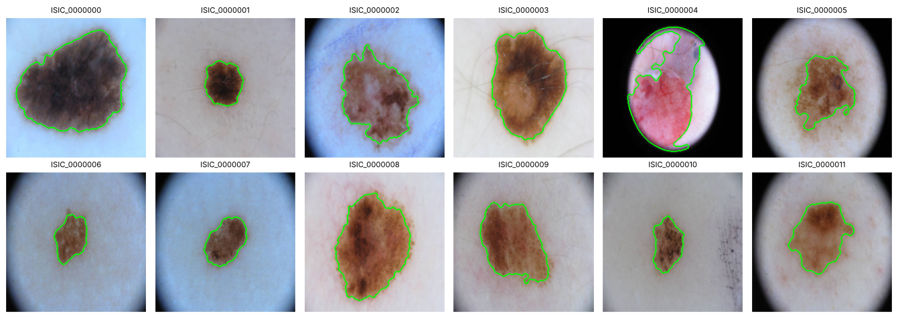

# Skin Lesion Segmentation

Team project by J Kowshik and K S Vinay Sathvik, completed in the second year of the B.E. in Artificial Intelligence and Machine Learning at B.N.M. Institute of Technology, Bengaluru.

Unsupervised segmentation of dermoscopic images from the Kaggle
[Skin Cancer: Malignant vs. Benign](https://www.kaggle.com/datasets/fanconic/skin-cancer-malignant-vs-benign)
dataset (224 x 224 RGB images from the ISIC archive). The notebook separates the lesion from the surrounding skin and crops a region of interest (ROI) that can be passed to a classifier.



*Lesion boundaries (green) on the first twelve images of the ISIC archive, resized to 224 x 224. ISIC_0000004 is a failure case: a red vascular lesion inside a small dermoscope field of view.*

## Method

1. **Field of view.** Dark regions connected to the image border are treated as the dermoscope vignette and excluded. Without this step the dark corners end up in the same cluster as the lesion.
2. **Clustering.** K-Means (k = 2, chosen from the elbow curve) on grayscale intensities inside the field of view. The darker cluster is the lesion candidate.
3. **Refinement.** Morphological opening and closing, hole filling and removal of small blobs. If several regions remain, the one that is large and close to the image centre is kept.
4. **ROI export.** The bounding box of the final mask is cropped, resized to 128 x 128 and written to `rois/<class>/`.

## Running

Open `Skin_Cancer_Lesion_Classification.ipynb` on Kaggle with the dataset attached, or in Google Colab, where the data cell downloads it with `kagglehub`. Then run all cells.

```sh
pip install -r requirements.txt
```

## Limitations

- The dataset has no ground-truth masks, so results are checked visually. The ISIC 2016 Task 1 masks would allow Dice or IoU evaluation.
- Low-contrast lesions (for example red vascular lesions) and dense hair are the main failure cases.
- No classifier is trained. The exported ROIs are the intended input for one.

## History

The original second-year notebook clustered the whole image and kept the smaller cluster, which often selected the dark dermoscope corners instead of the lesion. The field-of-view step and the region selection were added in a 2026 revision.
